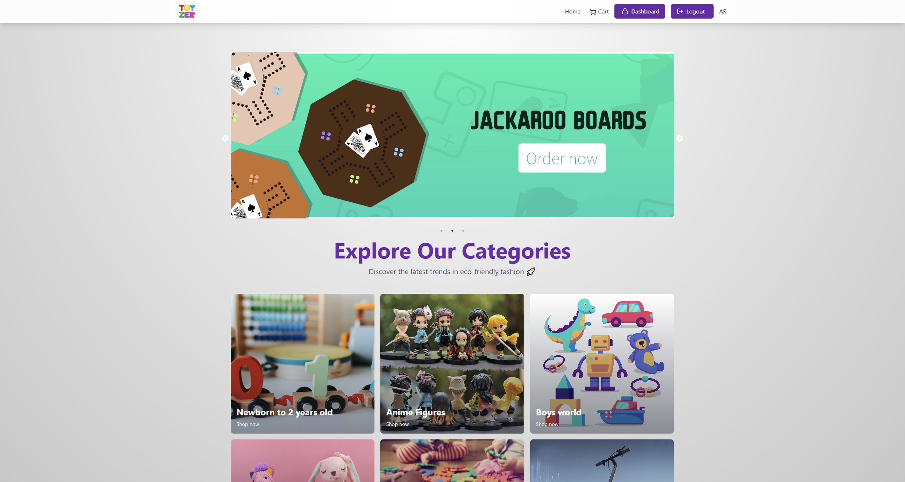
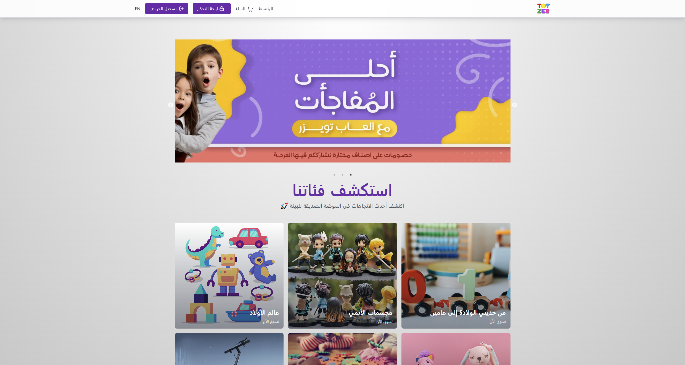

# Toyzer Store

[//]: # (Logo)


## Description

Toyzer Store is an e-commerce website specializing in toys and related products. It provides a platform for users to browse, purchase, and manage their favorite toys. The website is built using React for the frontend and Node.js with Express for the backend, with a MongoDB database.

[//]: # (Home Page Screenshot)


[//]: # (2nd Home Page Screenshot)

## Live Demo

🚀 **[View Live Demo](https://toyzer-store.onrender.com/)**

## Features

*   **Product Catalog:** Browse a wide variety of toys.
*   **User Authentication:** Secure user registration and login.
*   **Shopping Cart:** Add and manage items in a shopping cart.
*   **Checkout Process:** Secure and streamlined checkout process.
*   **Admin Dashboard:** Manage products, users, and orders.
*   **Localization:** Supports multiple languages (English and Arabic).

## Technologies Used

*   **Frontend:**
    *   React
    *   Tailwind CSS
    *   Framer Motion
    *   i18next
    *   Lucide React
*   **Backend:**
    *   Node.js
    *   Express
    *   Mongoose
    *   JSON Web Tokens (JWT)
    *   bcryptjs
    *   Cookie Parser
    *   Cors
    *   Dotenv
    *   Cloudinary
    *   Stripe
    *   UUID
    *   Redis
*   **Database:**
    *   MongoDB

## Setup Instructions

1.  **Clone the repository:**

    ```bash
    git clone https://github.com/Mohammed-M97/toyzer-store.git
    ```

2.  **Navigate to the project directory:**

    ```bash
    cd toyzer-store
    ```

3.  **Install dependencies:**

    ```bash
    npm install
    ```

4.  **Configure environment variables:**

    Copy `.env.example` to `.env` in the project root and fill it in:

    ```bash
    cp .env.example .env
    ```

    | Variable | Required | Notes |
    | --- | --- | --- |
    | `PORT` | no | Defaults to `5000`. |
    | `NODE_ENV` | no | Set to `production` on Render so the built frontend is served. |
    | `CLIENT_URL` | yes | Frontend origin. Used for Stripe redirects and the CORS allow-list. |
    | `MONGO_URI` | yes | Atlas connection string, including the database name. |
    | `UPSTASH_REDIS_URL` | no | Cache and refresh-token allow-list. The app runs without it. |
    | `JWT_ACCESS_TOKEN` | yes | Secret for 15-minute access tokens. |
    | `JWT_REFRESH_TOKEN` | yes | Secret for 7-day refresh tokens. |
    | `CLOUDINARY_CLOUD_NAME` | yes | Product image uploads. |
    | `CLOUDINARY_API_KEY` | yes | |
    | `CLOUDINARY_API_SECRET` | yes | |
    | `STRIPE_SECRET_KEY` | yes | Checkout sessions. |
    | `ADMIN_EMAIL` / `ADMIN_PASSWORD` | no | Only read by `npm run seed`. |

    Generate the two JWT secrets with:

    ```bash
    node -e "console.log(require('crypto').randomBytes(48).toString('base64url'))"
    ```

    The frontend needs no `.env` — Vite proxies `/api` to the backend in development
    and the backend serves the built assets in production.

5.  **Seed the database:**

    ```bash
    npm run seed
    ```

    Creates an admin account and a starter catalogue. See
    [docs/DEPLOYMENT.md](docs/DEPLOYMENT.md) for recreating the Atlas cluster
    from scratch.

6.  **Start the backend server:**

    ```bash
    npm run dev     # or: npm start
    ```

    Run this from the project root — there is no `package.json` inside `backend/`.

7.  **Start the frontend development server:**

    ```bash
    cd frontend
    npm run dev
    ```

## Usage

*   **Frontend:** Open your browser and navigate to `http://localhost:3000` (or the port specified in your frontend configuration).
*   **Backend:** The backend server will be running on `http://localhost:5000` (or the port specified in your .env file).

## Deployment

The project is deployed on Render: **[https://toyzer-store.onrender.com/](https://toyzer-store.onrender.com/)**

Health check: `GET /api/health` reports database and cache status.

See [docs/DEPLOYMENT.md](docs/DEPLOYMENT.md) for environment setup, recreating the
MongoDB Atlas cluster, keeping the free instance warm, and how the app behaves when
a dependency is unreachable.

## Contributing

Contributions are welcome! Please follow these steps:

1.  Fork the repository.
2.  Create a new branch for your feature or bug fix.
3.  Make your changes and commit them with descriptive messages.
4.  Push your changes to your fork.
5.  Submit a pull request.

## License

This project is licensed under the MIT License.

## Contact

Mohammed Alawlaqi - [mohammed-alawlaqi@outlook.com](mailto:mohammed-alawlaqi@outlook.com)